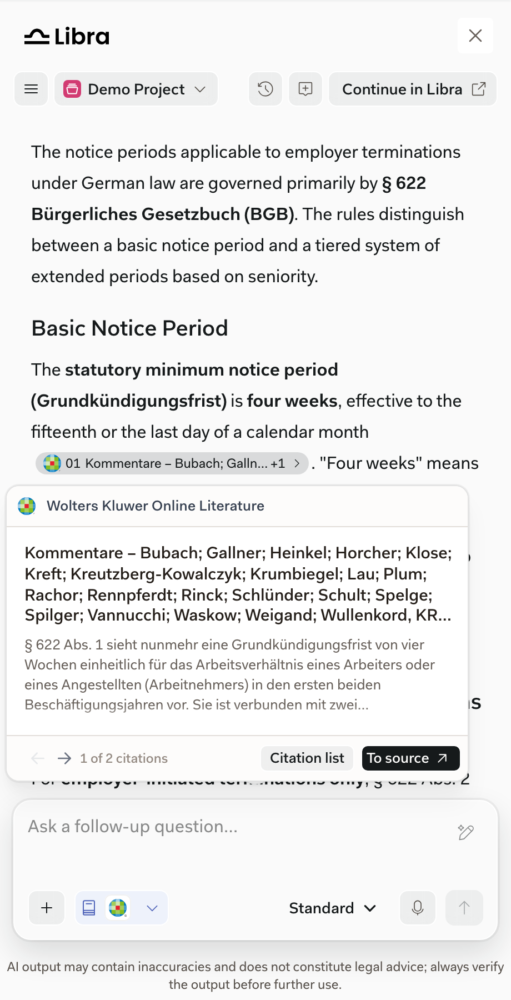

import { AnnotatedImage } from "/snippets/annotated-image.jsx"
import { screenshotMarkers } from "/snippets/screenshot-markers.jsx"

By default, a research citation opens its URL in a new browser tab. The provider's site may ask users to sign in.

<AnnotatedImage
  markers={screenshotMarkers["sdk-citation-preview"]}
  width={340}
  items={[
    { title: "Citation", text: "hover to preview the cited passage, click to open it." },
    { title: "Citation list", text: "shows every source the answer cites." },
    { title: "To source", text: "opens the cited passage." },
  ]}
>
  
</AnnotatedImage>

If your product hosts the cited source, it can open the citation itself, for example in its own document view. Claim a citation with the `onCitationClick` callback and `preventDefault()`. Unclaimed citations keep the default. Clicking the citation and **To source** both call `onCitationClick`.

| Citation | Default behavior | When your product claims it |
| --- | --- | --- |
| Research source owned by your product | Opens in a new tab | Opens wherever your product chooses |
| Research source owned by another provider | Opens in a new tab | Leave it unclaimed |
| Document the user uploaded to Libra | Opens in the [Document Viewer](/capabilities/document-viewer) | Not sent to your product |

The citation event contains `source`, `url`, and the cited passage's text as `content` when it's available. Other citation fields are internal.

See [Host integrations](/integration/host-integrations) and [Navigation and handoffs](/integration/navigation-and-handoffs) for implementation details.
