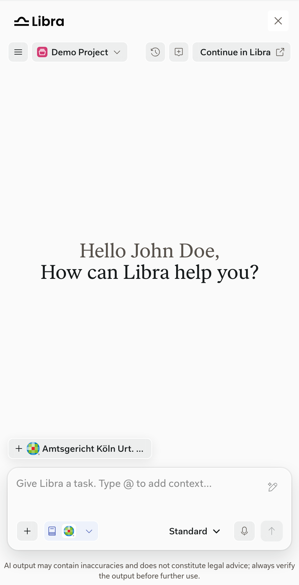
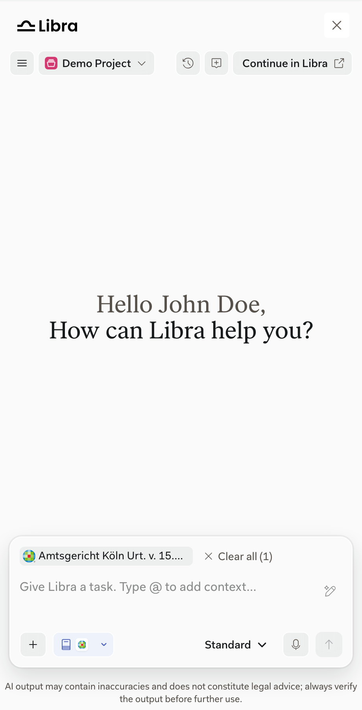

When a user opens or selects a document in your product, your product can suggest it to Libra. The SDK shows the suggestion as a chip above the chat input. Selecting the chip adds the document to the chat input. Related attachments, such as a PDF of the same document, can come with it.

<Columns cols={2}>
  <Frame caption="The suggestion chip above the chat input.">
    
  </Frame>
  <Frame caption="After selecting the chip, the document is in the chat input.">
    
  </Frame>
</Columns>

Your product can also attach documents or files directly, without a suggestion.

| What your product does | What users see |
| --- | --- |
| Suggests the current document with `setSuggestedAttachment()` | A suggestion chip above the chat input |
| Clears the suggestion with `clearSuggestedAttachment()` | The suggestion disappears; anything already attached stays |
| Attaches documents or files with `addAttachments()` | The attachments appear in the chat input |
| Removes host attachments with `clearAttachments()` | Attachments your product added are removed; the user's own uploads stay |

## Availability

Your product owns document identity, URLs, permissions, and product access.

<Warning>
**FAB index required.** Libra can use a research document only if it's already in your product's FAB index. Libra checks the index but doesn't add documents to it.
</Warning>

Libra checks each research document together with its related attachments:

- **Suggested documents** are checked in the background while the chip is visible. If any document in the group is unavailable, selecting the chip attaches nothing and shows a **Content unavailable** notice.
- **Attached documents** show a loading state while they're checked. Unavailable documents stay in the chat input, disabled, and block sending until the user removes them. A notice offers **Try again** and **Remove**.
- **Files** that your product passes from memory skip the check. Libra uploads them to the user's active project and indexes them like any upload.

Documents from legal software products aren't in the FAB index. Libra adds them to the user's active project and starts indexing them; a suggested document is added only when the user selects its chip. They become available when indexing finishes, or disabled if the user has no connection to the product, the product isn't enabled for the team, or indexing takes longer than 90 seconds.

Your product doesn't receive the result of these checks.

See [Suggest an attachment](/integration/suggestions), [Add attachments](/integration/add-attachments), and [Attachments and availability](/integration/attachments) for the integration contract and examples.
