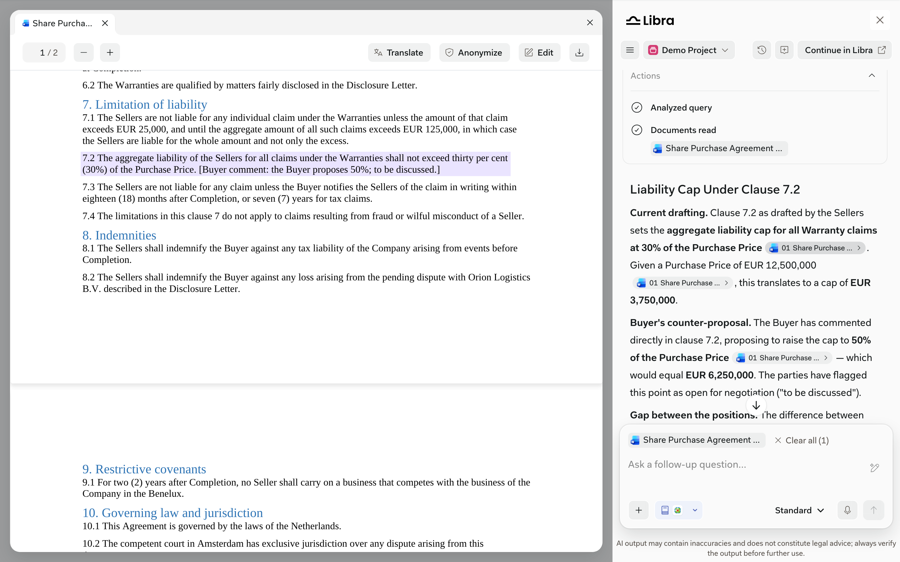
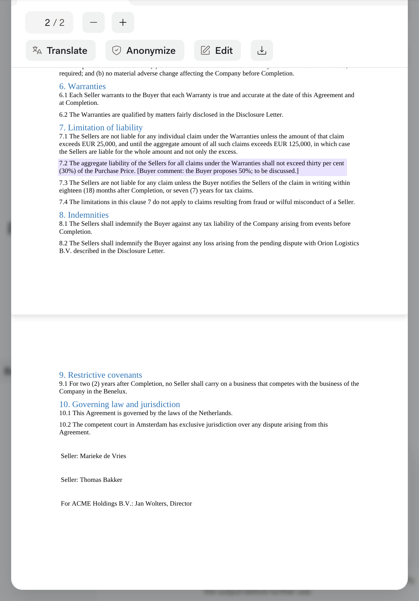
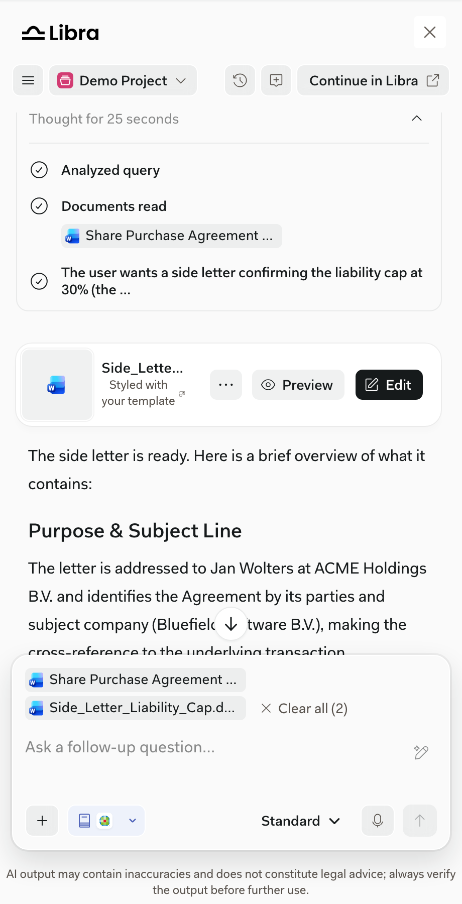
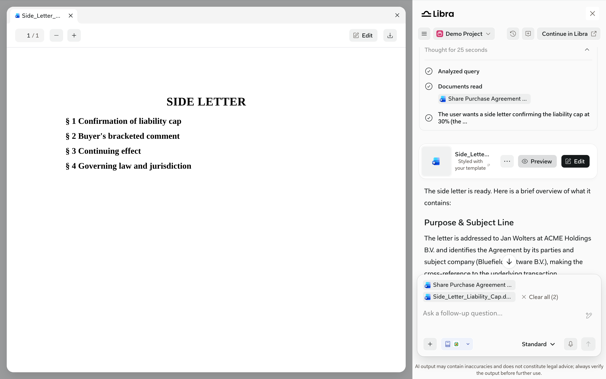

The Document Viewer opens beside the SDK window when users select a cited uploaded or legal software document, select an attached legal software document in the chat input, or preview a generated document. It opens on the cited page and highlights the cited passage. If there isn't room beside the window, the viewer covers it.

The SDK manages the viewer for you. It isn't a separate component your product mounts, and its language follows the chat.

*Selecting a document pill in an answer opens the viewer on the cited page. The toolbar shows the page indicator, zoom, Translate, Anonymize, Edit, and Download.*

<Frame caption="Selecting a document pill opens the Document Viewer beside the SDK window.">
  <video autoPlay muted loop playsInline src="/videos/capabilities/document-viewer-flow.mp4"></video>
</Frame>

## Narrow screens

<Frame caption="In a 600px browser window there's no room beside the SDK window, so the viewer covers it.">
  
</Frame>

## Generated documents

<Columns cols={2}>
  <Frame caption="A Word document drafted with Tools > Start drafting > Word.">
    
  </Frame>
  <Column>

  When Libra drafts a document, the answer shows a document card:

  - **Preview** opens the document in the Document Viewer.
  - **Edit** opens the drafting editor in Libra Workspace in a new tab. Editing isn't available inside the SDK window.

  Your product doesn't receive a callback for either action.

  </Column>
</Columns>

*Preview opens the generated document in the Document Viewer. The viewer's **Edit** button hands off to Libra Workspace.*

## Your product's responsibilities

- Allow `blob:` workers in your Content Security Policy so the viewer renders PDFs efficiently.
- Don't depend on the viewer's internal frames, messages, or layout.

See [Document Viewer integration](/integration/document-viewer), [Deployment security](/integration/deployment-security), and [Production readiness](/integration/production-readiness).
