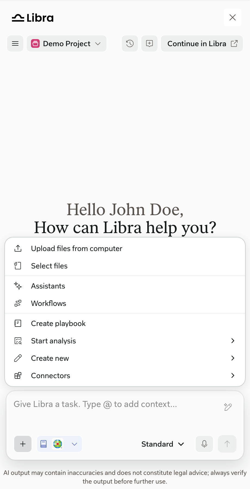
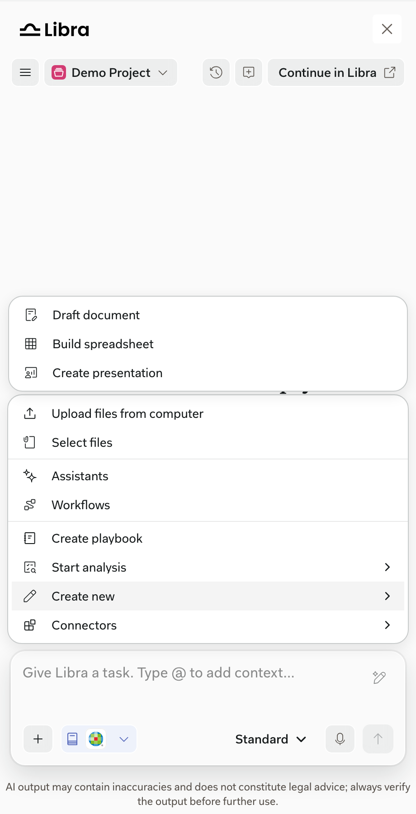
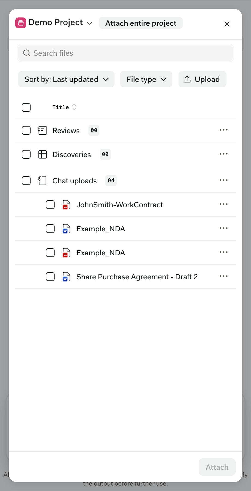
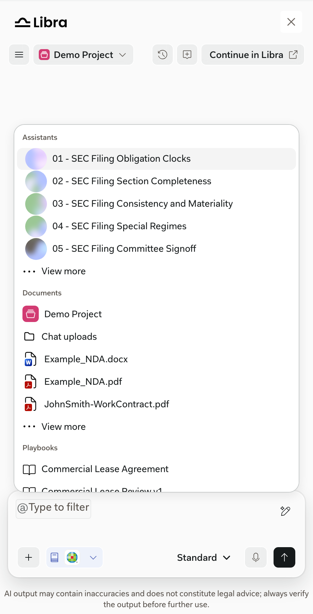

Libra-native: the SDK doesn't control them. Full documentation: [Project files](https://docs.libratech.ai/en/features/documents/library), [File types and previews](https://docs.libratech.ai/en/features/documents/file-types), [Chat tools](https://docs.libratech.ai/en/features/chat/tools), and [Workflow basics](https://docs.libratech.ai/en/features/workflows/basics).

## Tools menu

<Columns cols={2}>
  <Frame caption="Tools: upload or select files, Assistants, Workflows, playbooks, analysis, Create new, and Connectors.">
    
  </Frame>
  <Frame caption="Create new: draft a document, build a spreadsheet, or create a presentation.">
    
  </Frame>
</Columns>

Drafted documents open in the [Document Viewer](/capabilities/document-viewer#generated-documents).

## Workflows

**Tools** > **Workflows** opens the Workflows browser in the SDK window. Users can search and filter their own, shared, and Libra Workflows.

- **Run** starts the Workflow in the SDK window. Its steps appear above the chat input, where users can add instructions before sending.
- **View** and creating a new Workflow open Libra Workspace in a new tab.

A Workflow chat started in the SDK window is also available in Libra Workspace. See [Handoffs to Libra](/capabilities/handoffs).

## Files and context

<Columns cols={2}>
  <Frame caption="Tools > Select files opens the File Picker. Users can search, sort, filter, upload, or attach a whole project.">
    
  </Frame>
  <Frame caption="Typing @ in the chat input adds Assistants, documents, or playbooks as context.">
    
  </Frame>
</Columns>

## In the SDK window

- What appears in the File Picker depends on file permissions, connections, indexing, and product access.
- Your product doesn't control the File Picker or the Tools menu. To offer the document the user is working on, see [Current-document context](/capabilities/current-document).
