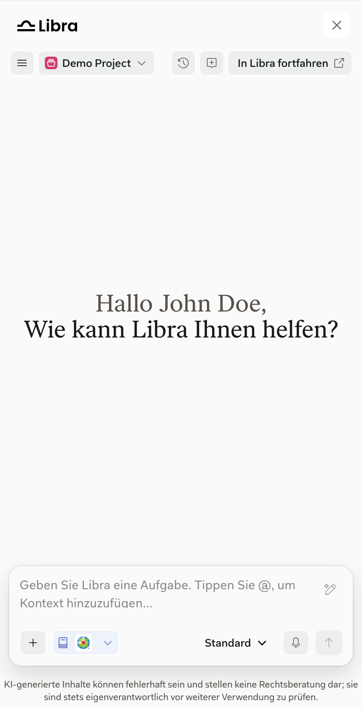

The SDK ships with English (`en-US`). Your product loads the other languages it needs and chooses which one to show.

- **At startup**, your product sets the language with the `locale` option. Without it, the SDK uses the browser's language.
- **While the window is open**, your product can switch the language with `Libra.setLocale()`. The chat keeps its conversation, and the [Document Viewer](/capabilities/document-viewer) follows the new language.

Your product must load every language it may switch to before starting the SDK. Starting or switching to a language that wasn't loaded fails.

<Frame caption="The SDK window in German (de-DE).">
  
</Frame>

See [Locales](/integration/locales) for setup and the list of supported languages.
