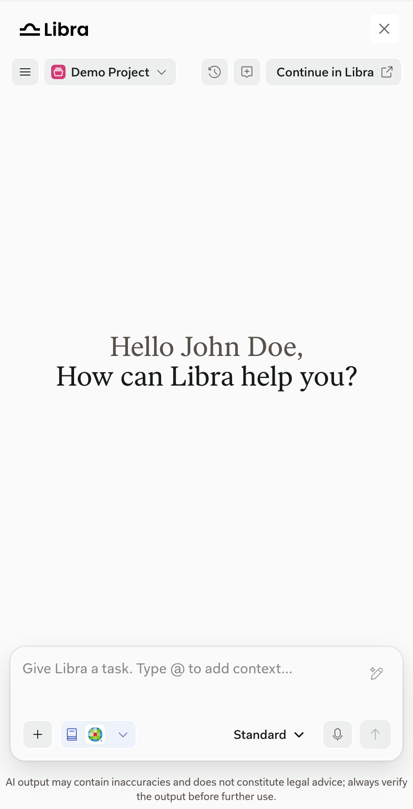

import { AnnotatedImage } from "/snippets/annotated-image.jsx"
import { screenshotMarkers } from "/snippets/screenshot-markers.jsx"

Capabilities fall into two groups:

- **SDK-specific** capabilities were built for the SDK. The SDK controls them, so your product can control them too where the SDK offers a setting.
- **Libra-native** capabilities come from the Libra app. The SDK doesn't control them. The [Libra documentation](https://docs.libratech.ai/en/getting-started/welcome) covers them in full; these pages show how they look in the SDK window.

## The SDK window at a glance

<AnnotatedImage
  markers={screenshotMarkers["sdk-layout"]}
  width={340}
  items={[
    { title: "Libra wordmark", text: "shown with Close when your product provides onClose." },
    { title: "Close", text: "closes the SDK window." },
    { title: "Menu", text: "Sign Out." },
    { title: "Project selector", text: "switches the active project." },
    { title: "Chat History", text: "reopens earlier chats." },
    { title: "New chat", text: "starts a blank chat." },
    { title: "Continue in Libra", text: "opens the current chat in Libra Workspace." },
    { title: "Greeting", text: "shown in an empty chat. Questions and answers appear here." },
    { title: "Chat input", text: "type a task, or type @ to add context." },
    { title: "Improve", text: "rewrites the prompt before sending." },
    { title: "Tools", text: "files, Assistants, Workflows, drafting, and connectors." },
    { title: "Research sources", text: "the logos show the selected sources. Select to change them." },
    { title: "Chat mode", text: "Standard, Deep Thinking, or Fast." },
    { title: "Voice input", text: "dictate a prompt." },
    { title: "Send", text: "sends the prompt." },
    { title: "Legal notice", text: "a reminder to verify AI output." },
  ]}
>
  
</AnnotatedImage>

## SDK-specific capabilities

<Columns cols={2}>
  <Card title="SDK window and header" icon="panel-right" href="/capabilities/sdk-window">
    Where the SDK window opens and what the header contains.
  </Card>
  <Card title="Current-document context" icon="file-plus" href="/capabilities/current-document">
    Suggest or attach the document the user is working on.
  </Card>
  <Card title="Citation navigation" icon="link" href="/capabilities/citation-navigation">
    Open research citations in your product instead of a new tab.
  </Card>
  <Card title="Document Viewer" icon="file-text" href="/capabilities/document-viewer">
    Preview cited and generated documents beside the chat.
  </Card>
  <Card title="Sign-in and onboarding" icon="user-check" href="/capabilities/sign-in-and-onboarding">
    How users sign in, create an account, and get started.
  </Card>
  <Card title="Language" icon="languages" href="/capabilities/language">
    Show the SDK window in the user's language.
  </Card>
  <Card title="Handoffs to Libra" icon="external-link" href="/capabilities/handoffs">
    When and how users continue in Libra Workspace.
  </Card>
</Columns>

## Libra-native capabilities

<Columns cols={2}>
  <Card title="Chat and answers" icon="messages-square" href="/capabilities/chat-and-answers">
    Ask, refine, and reuse answers.
  </Card>
  <Card title="Research sources and citations" icon="book-open" href="/capabilities/research-sources-and-citations">
    Choose sources and check what an answer cites.
  </Card>
  <Card title="Files and tools" icon="wrench" href="/capabilities/files-and-tools">
    Add files and context, run Workflows, and start drafting.
  </Card>
  <Card title="Assistants, history, and projects" icon="folder-open" href="/capabilities/assistants-history-projects">
    Run Assistants and pick up earlier work.
  </Card>
</Columns>

## What depends on the user's account

- **Subscription.** Some features are hidden or show an upgrade prompt.
- **Product access.** It decides which research sources users can choose.
- **Their own content.** Projects, files, Assistants, and Workflows come from the user's account and team. New files appear after indexing.
