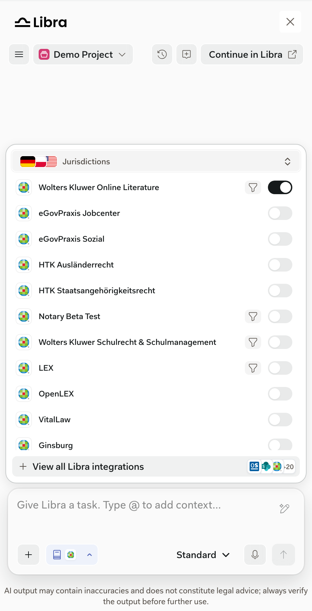
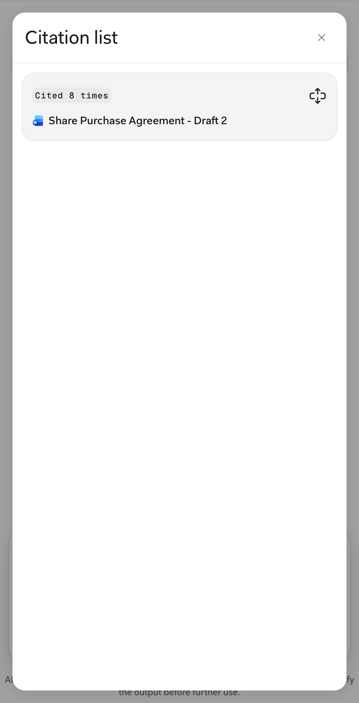

Libra-native: the SDK doesn't control them. Full documentation: [Citations and sources](https://docs.libratech.ai/en/features/chat/citations) and [Research mode](https://docs.libratech.ai/en/features/chat/research-mode).

<Columns cols={2}>
  <Frame caption="The research selector lists the sources available to the user, grouped by jurisdiction.">
    
  </Frame>
  <Frame caption="The citation list groups every source cited in an answer.">
    
  </Frame>
</Columns>

## In the SDK window

- Answers cite their sources inline. Users can open the full citation list from below the answer.
- The sources users can choose depend on their account and product access. Your product can preselect sources; see [Your product preselects sources](#your-product-preselects-sources).
- Research citations open in a new tab unless your product opens them itself. See [Citation navigation](/capabilities/citation-navigation).
- Citations of uploaded documents open in the [Document Viewer](/capabilities/document-viewer).

## Your product preselects sources

`researchSources` in `Libra.init()` sets which sources are selected when the SDK starts. It's only the starting point:

- The user's changes last for the rest of the session: across projects, new chats, and messages.
- **Continue in Libra** carries the current selection over to Libra Workspace.
- Reloading the page starts again from `researchSources`.
- The SDK doesn't save the selection to the user's Libra account, so it never changes their choices in Libra Workspace.

See the [API reference](/reference/overview) for the source IDs.
