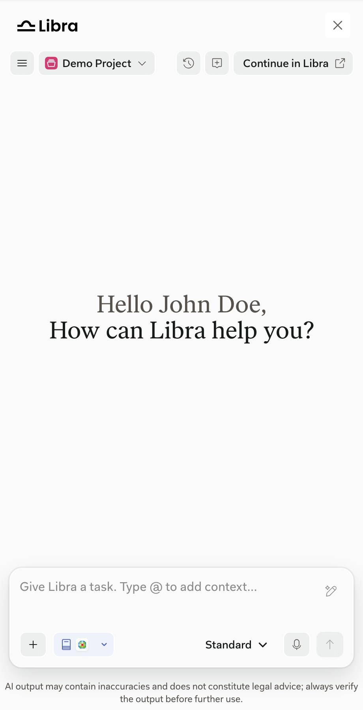
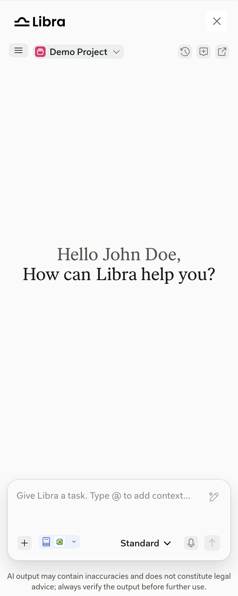

import { AnnotatedImage } from "/snippets/annotated-image.jsx"
import { screenshotMarkers } from "/snippets/screenshot-markers.jsx"

Your product decides when and where the SDK window opens, how wide it is, and whether users can resize it. Hiding and showing the window keeps the chat session.

## The Libra button

Users open the SDK window with a Libra button in your product. The SDK doesn't render this button: your product builds it, places it, and calls `Libra.attach()` when users select it.

- **Brand it as Libra**, so users recognize the entry point.
- **Place it where it fits your layout**, and keep it in the same place on every page, so users can always find it.
- **Put it in your product's header.** Many products already do. Avoid a floating button: in the first integrations, users tended to overlook floating buttons.

See the [Quickstart](/integration/quickstart) for a minimal button that opens and closes the SDK window.

## The header

<AnnotatedImage
  markers={screenshotMarkers["sdk-home"]}
  items={[
    { title: "Close", text: "closes the SDK window. Shown only when your product provides onClose; your product decides what closing does." },
    { title: "Menu", text: "contains Sign Out." },
    { title: "Project selector", text: "switches the active project." },
    { title: "Chat History", text: "finds and reopens earlier chats." },
    { title: "New chat", text: "starts a blank conversation." },
    { title: "Continue in Libra", text: "opens the current chat in Libra Workspace in a new tab." },
  ]}
>
  
</AnnotatedImage>

The top bar with the Libra wordmark and **Close** is optional. If your product has its own close control, leave out `onClose`. The chat controls always appear.

## Width

<Columns cols={2}>
  <Frame caption="At 360px, Continue in Libra shows only its icon.">
    
  </Frame>
  <Column>

  The SDK window adapts to the width your product gives it. Header labels appear as the window gets wider:

  - From 421px: **Continue in Libra**.
  - From 640px: **Chat History** and **New chat**.

  A wider window doesn't add features.

  </Column>
</Columns>

## Your product's responsibilities

- Keep the target element in the page, with usable width and height, while the SDK window is open.
- Avoid CSS that creates a containing block on the target's ancestors, such as `transform` or `filter`. It misplaces the window.
- Hide your surrounding panel when users close the window.

See [Quickstart](/integration/quickstart), [Header ownership](/integration/lifecycle#header-ownership), and [Embedding and layout constraints](/integration/embedding-constraints). The exact contract is in the [API reference](/reference/overview).
