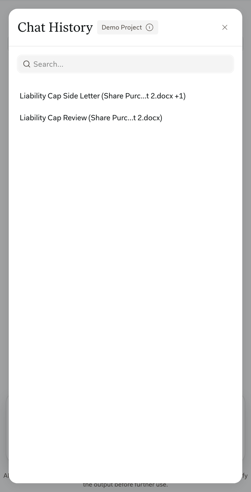
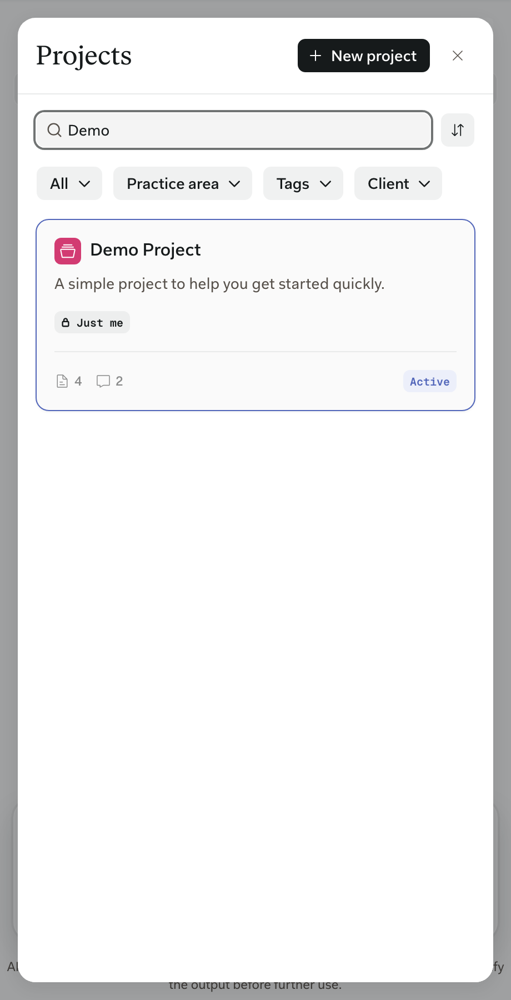

Libra-native: the SDK doesn't control them. Full documentation: [Assistants](https://docs.libratech.ai/en/features/assistants/introduction), [Projects](https://docs.libratech.ai/en/features/projects), and [Chat basics](https://docs.libratech.ai/en/features/chat/basics).

## In the SDK window

- **Assistants.** **Tools** > **Assistants** opens the Assistants browser, and users can also add an Assistant by typing **@** in the chat input. **Run** starts the Assistant in the SDK window. **View** and creating a new Assistant open Libra Workspace in a new tab.
- **Chat History.** Users can search earlier conversations and reopen them from the header.
- **Projects.** Users can switch projects from the header. Switching starts a new chat in the selected project.
- **Synchronization.** Chats are the same in the SDK window and Libra Workspace. **Continue in Libra** opens the current chat there.

See [Handoffs to Libra](/versions/v0.15.0/capabilities/handoffs) for everything that opens Libra Workspace.

<Columns cols={2}>
  <Frame caption="Chat History lists the chats in the active project.">
    
  </Frame>
  <Frame caption="Projects: search, filter, or create a project.">
    
  </Frame>
</Columns>
