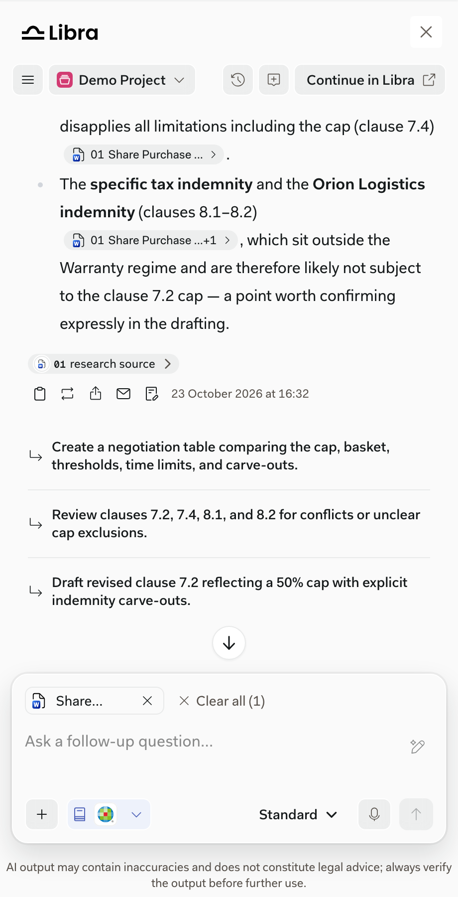
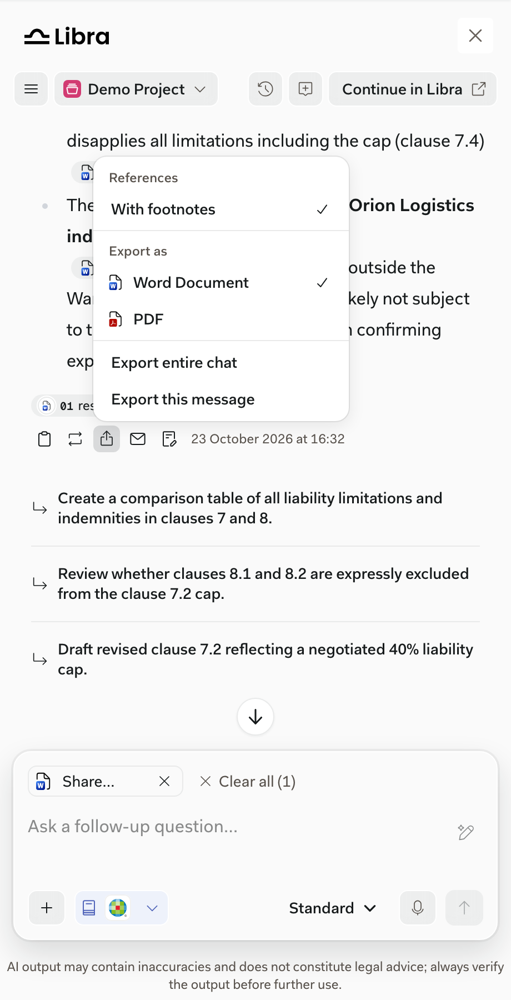
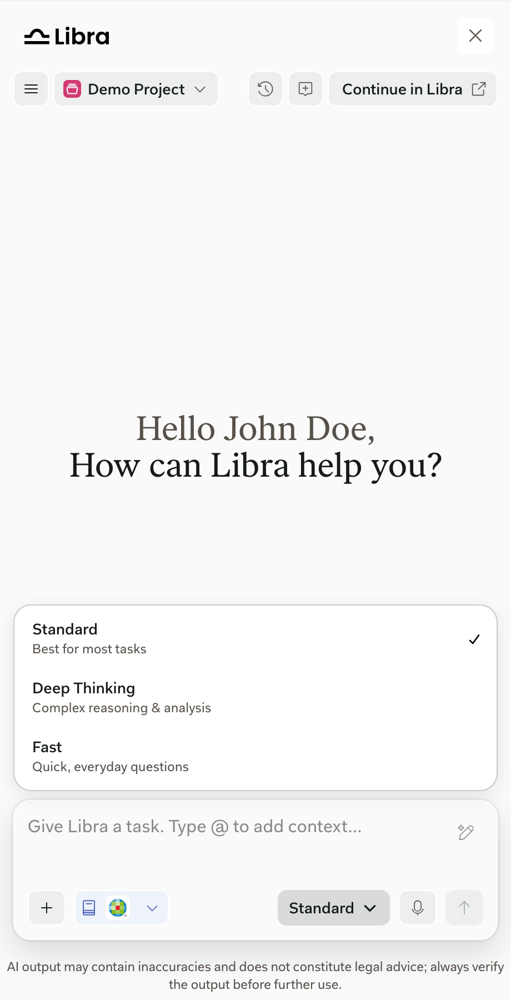
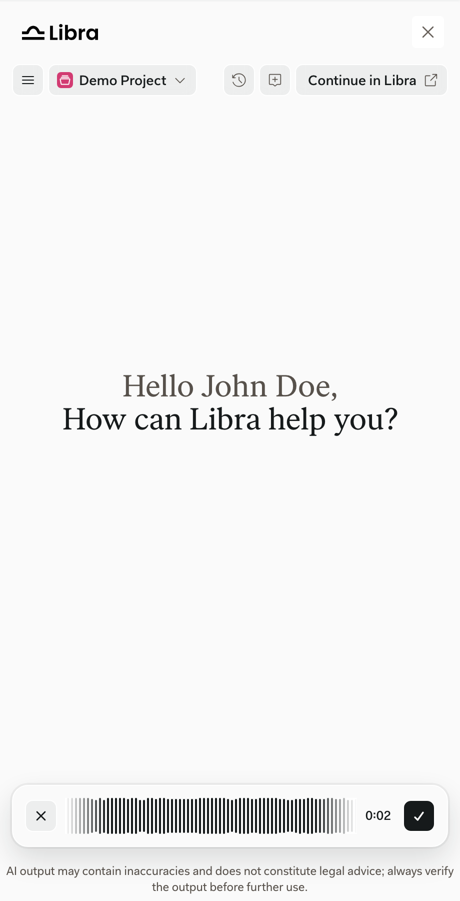
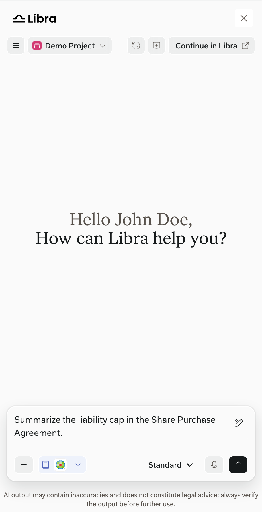

import { AnnotatedImage } from "/snippets/annotated-image.jsx"
import { screenshotMarkers } from "/versions/v0.15.0/snippets/screenshot-markers.jsx"

Libra-native: the SDK doesn't control it. Full documentation: [Chat basics](https://docs.libratech.ai/en/features/chat/basics) and [Chat tools](https://docs.libratech.ai/en/features/chat/tools).

Users type a task in the chat input, can improve the prompt before sending it, and can stop an answer while it's generated.

## Work with an answer

<AnnotatedImage
  markers={screenshotMarkers["sdk-answer-actions"]}
  width={340}
  markerSize={18}
  items={[
    { title: "Copy", text: "copies the answer." },
    { title: "Regenerate", text: "generates a new answer." },
    { title: "Export", text: "saves the message or the whole chat as Word or PDF." },
    { title: "Create email", text: "drafts an email from the answer." },
    { title: "Open in editor", text: "opens the answer in the drafting editor in Libra Workspace, in a new tab." },
  ]}
>
  
</AnnotatedImage>

Suggested next steps appear below the answer.

<Columns cols={2}>
  <Frame caption="Export options: references, Word or PDF, and this message or the whole chat.">
    
  </Frame>
  <Frame caption="Chat mode: Standard, Deep Thinking, or Fast.">
    
  </Frame>
</Columns>

## Voice input

Users can dictate a task instead of typing it:

1. Click the microphone in the chat input. The browser asks for microphone access the first time.
2. Speak. A timer shows the recording length.
3. Click the check mark to transcribe, or the cross to cancel.

The text is added to the chat input. Users review it and send it themselves. If a user has turned on **Instant Auto-Send After Voice Transcription** in their Libra settings, the message is sent as soon as the text arrives. The SDK window has no settings, so users change this in Libra Workspace.

<Columns cols={2}>
  <Frame caption="Recording.">
    
  </Frame>
  <Frame caption="Transcribed text in the chat input.">
    
  </Frame>
</Columns>

If your page sets a `Permissions-Policy` header, it must allow the microphone. See [Deployment security](/versions/v0.15.0/integration/deployment-security#framing-and-permissions-policy).

## In the SDK window

- Menus open above the chat input.
- Chats are shared with Libra Workspace. See [Handoffs to Libra](/versions/v0.15.0/capabilities/handoffs).
