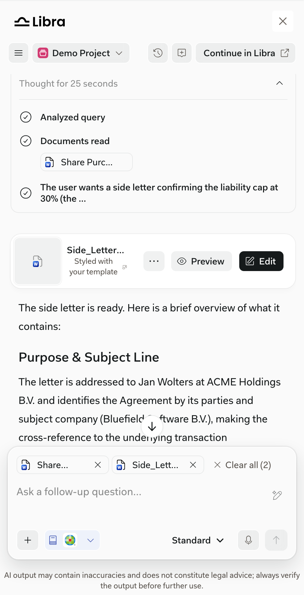

Most work, including running Workflows and Assistants, happens inside the SDK window. Some actions open Libra Workspace in a new browser tab. Chats are shared between the two: a conversation started in the SDK window is the same conversation in Libra Workspace, so users can continue in either place.

| Action | Where it starts | What opens in Libra Workspace |
| --- | --- | --- |
| **Continue in Libra** | SDK window header | The current chat, with the same conversation. From a new chat, Libra Workspace opens with the same research sources selected. |
| **Open in editor** | Below an answer | The answer in the drafting editor. |
| **Edit** | Generated document card or Document Viewer | The generated document in the drafting editor. |
| **View** a Workflow or Assistant | **Tools** > **Workflows** or **Assistants** | The Workflow or Assistant details. |
| Create a Workflow or Assistant | **Tools** > **Workflows** or **Assistants** | A new Workflow or Assistant. |

**Run** on a Workflow or Assistant stays in the SDK window: it starts in the chat input. See [Files and tools](/versions/v0.15.0/capabilities/files-and-tools) and [Assistants, history, and projects](/versions/v0.15.0/capabilities/assistants-history-projects).

<Frame caption="Edit on a generated document opens the drafting editor in Libra Workspace.">
  
</Frame>

## What your product controls

- **Reopen a saved chat.** Your product can open an existing chat in the SDK window with `Libra.openChatById()`, for example from a link in your own interface. Check that the chat belongs to the signed-in user first.
- **Open citations in your product.** See [Citation navigation](/versions/v0.15.0/capabilities/citation-navigation).

Your product doesn't receive a callback when users open Libra Workspace, and the SDK doesn't offer other navigation into it. Keep any other links to Libra in your own interface.

See [Navigation and handoffs](/versions/v0.15.0/integration/navigation-and-handoffs) for implementation details.
