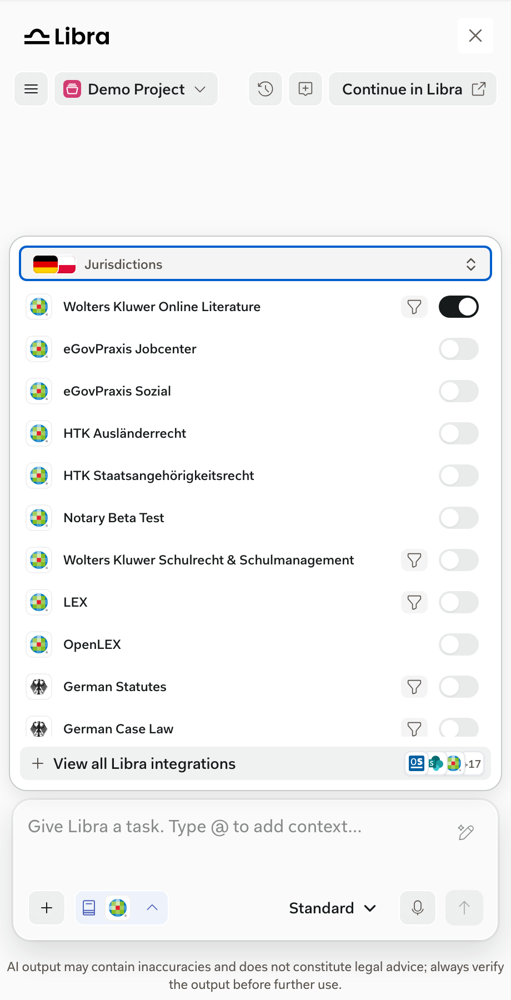
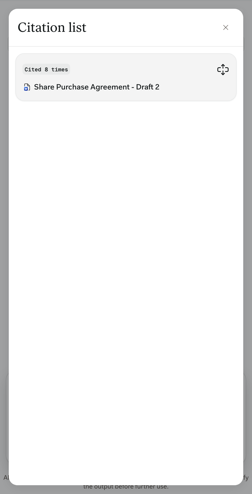

Libra-native: the SDK doesn't control them. Full documentation: [Citations and sources](https://docs.libratech.ai/en/features/chat/citations) and [Research mode](https://docs.libratech.ai/en/features/chat/research-mode).

<Columns cols={2}>
  <Frame caption="The research selector lists the sources available to the user, grouped by jurisdiction.">
    
  </Frame>
  <Frame caption="The citation list groups every source cited in an answer.">
    
  </Frame>
</Columns>

## In the SDK window

- Answers cite their sources inline. Users can open the full citation list from below the answer.
- The sources users can choose depend on their account and product access. Your product can preselect sources with the `researchSources` option. See the [API reference](/versions/v0.15.0/reference/overview).
- Research citations open in a new tab unless your product opens them itself. See [Citation navigation](/versions/v0.15.0/capabilities/citation-navigation).
- Citations of uploaded documents open in the [Document Viewer](/versions/v0.15.0/capabilities/document-viewer).
