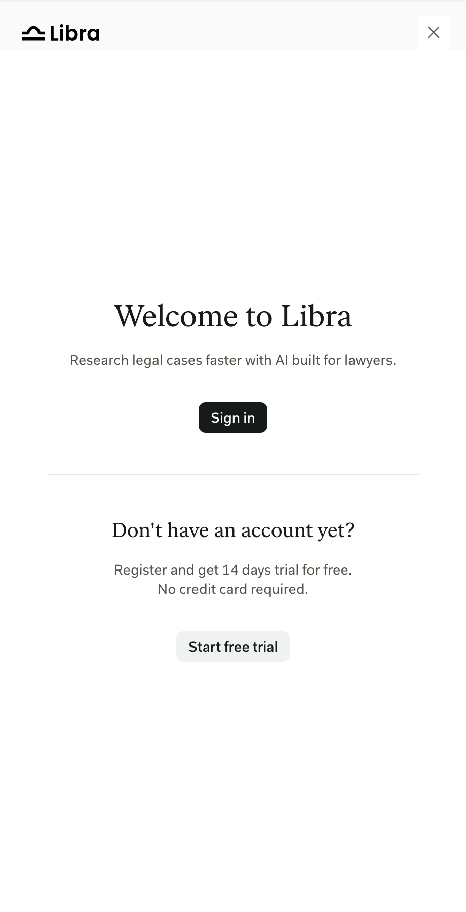
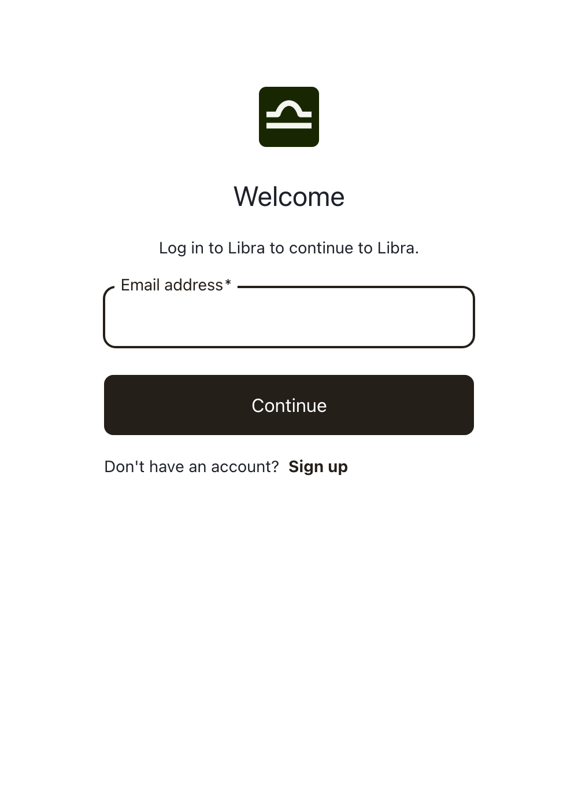
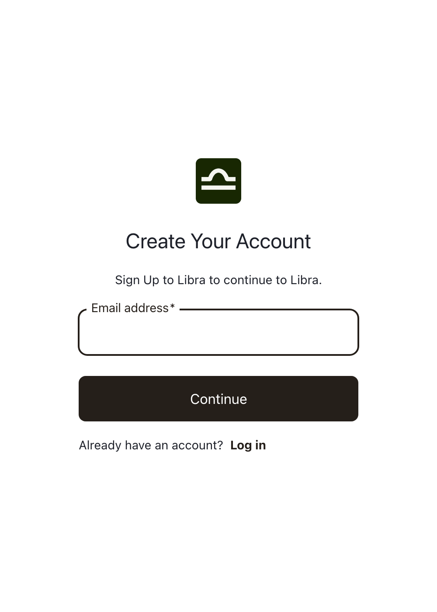
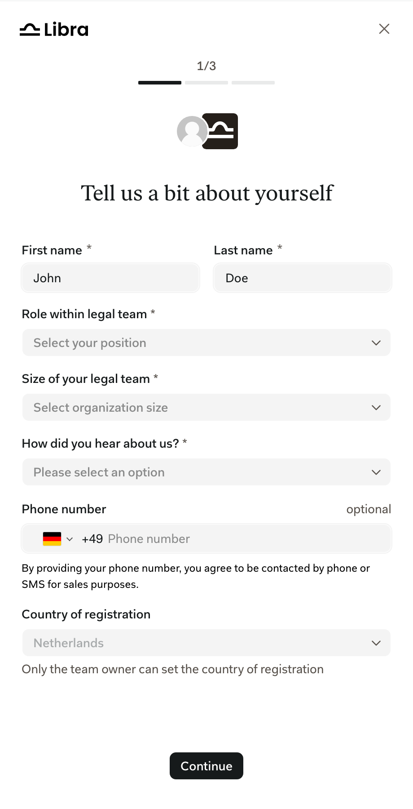
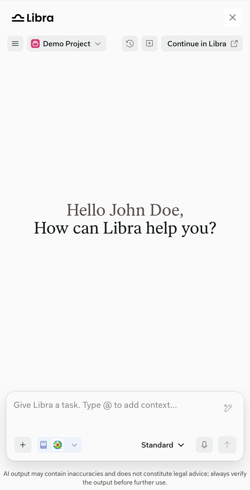
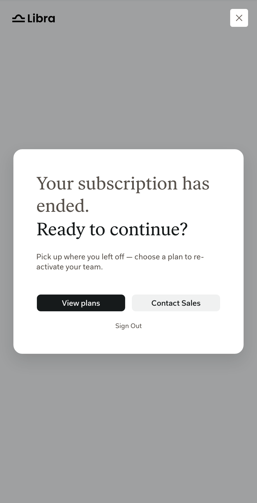
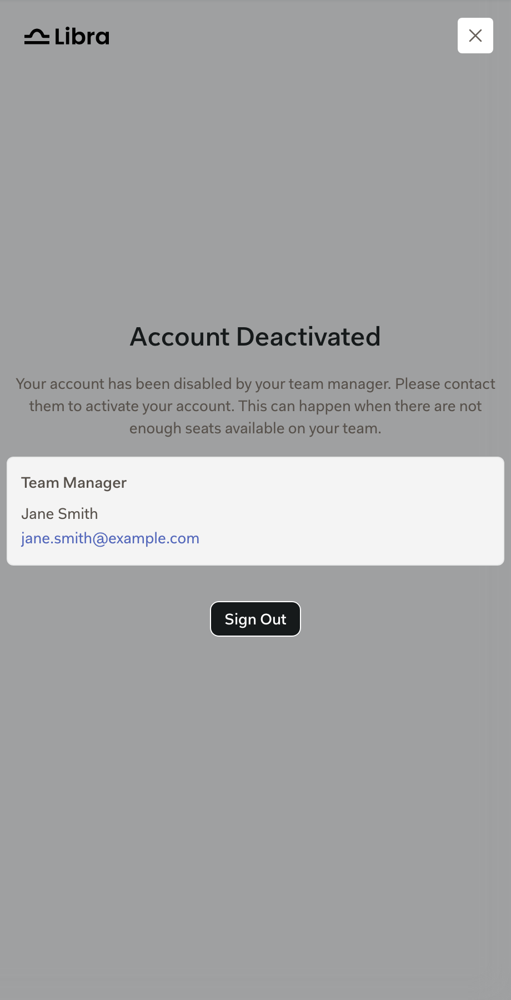
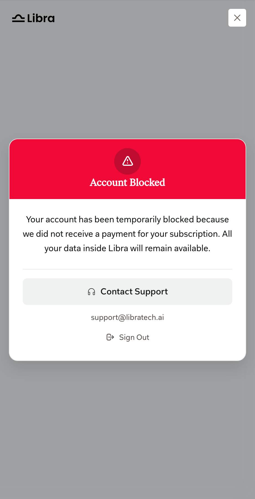

The SDK handles sign-in for your product. Users with a valid session go straight to the chat. Everyone else goes through these steps.

<Steps>
  <Step title="Welcome screen">
    Users without a session see the Libra welcome screen in the SDK window.

    <Frame>
      
    </Frame>
  </Step>
  <Step title="Sign in or create an account">
    **Sign in** and **Start free trial** open a Libra popup window. Users can switch between the two from the popup.

    <Columns cols={2}>
      <Frame caption="Sign in.">
        
      </Frame>
      <Frame caption="Start free trial.">
        
      </Frame>
    </Columns>
  </Step>
  <Step title="Onboarding">
    New accounts complete onboarding in the SDK window before the chat appears:

    1. **Personal info:** name, role, team size, country of registration, how they heard about Libra, and an optional phone number.
    2. **Account and workspace:** jurisdictions of practice, workspace language, and newsletter.
    3. **Team:** invite colleagues. Only users who start a new team see this step.
    4. **Email verification:** shown until the user verifies their email.

    Users who join an existing team see three steps.

    <Frame caption="Step 1 of 3 for a user joining an existing team.">
      
    </Frame>
  </Step>
  <Step title="Chat">
    The chat opens. See [SDK window and header](/versions/v0.15.0/capabilities/sdk-window).

    <Frame>
      
    </Frame>
  </Step>
</Steps>

## Account screens

If an account can't use Libra, the SDK shows one of these screens instead of the chat. Team admins don't see them.

<Columns cols={3}>
  <Frame caption="The subscription or trial has ended. View plans opens Libra Workspace.">
    
  </Frame>
  <Frame caption="The team manager has deactivated the account, for example when the team has no free seats.">
    
  </Frame>
  <Frame caption="The team's subscription payment is missing. Data stays available.">
    
  </Frame>
</Columns>

Every account screen has **Sign Out**, which returns users to the welcome screen.

## What your product receives

- `onAuthStateChange` reports when a session is restored, a user signs in or creates an account, or a user signs out.
- `onAuthError` reports a failed sign-in or account creation, for example a blocked or closed popup.
- `Libra.signOut()` signs the user out from your product.

Products that already authenticate their users can sign them in to Libra through a backend proxy instead. See [BFF and proxy authentication](/versions/v0.15.0/integration/bff-authentication).

See [Authentication](/versions/v0.15.0/integration/authentication) in the Integration guide and [Trusted origins](/versions/v0.15.0/integration/trusted-origins).
