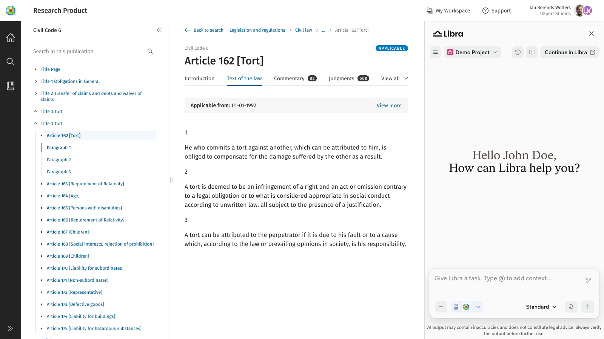

Integrate Libra's AI-powered legal research and conversational capabilities into a host product. Learn how the solution works, choose the right integration path, and find the public SDK contract.

*Libra open beside a host research product.*

<CardGroup cols={2}>
  <Card title="Quickstart" icon="rocket" href="/versions/v0.15.0/integration/quickstart">
    Follow the minimum implementation path for engineers and QA teams.
  </Card>
  <Card title="Playground" icon="flask-conical" href="/versions/v0.15.0/integration/playground">
    Try each SDK call in the hosted playground without writing code.
  </Card>
</CardGroup>

## What would you like to do?

Choose the path that best matches what you need today. You can move freely between functional, design, and technical documentation.

<CardGroup cols={2}>
  <Card title="Solution overview" icon="house" href="/versions/v0.15.0/solution/overview">
    Understand the solution, its scope, and its terminology.
  </Card>
  <Card title="Capabilities" icon="sparkles" href="/versions/v0.15.0/capabilities/overview">
    See what users can do in the SDK window, with screenshots of each capability.
  </Card>
  <Card title="Integration guide" icon="plug" href="/versions/v0.15.0/integration/overview">
    Set up, implement, and deploy an integration.
  </Card>
  <Card title="API reference" icon="book-open" href="/versions/v0.15.0/reference/overview">
    Look up exact methods, configuration, callbacks, types, and technical contracts.
  </Card>
  <Card title="Status and support" icon="life-buoy" href="/versions/v0.15.0/status/overview">
    Check the reviewed SDK version, current limitations, release notes, and support options.
  </Card>
</CardGroup>

## Libra inside your product

The Libra Assistant SDK embeds Libra's conversational research capabilities in a host product, so people can work with supported in-context content without leaving that workflow. Depending on host configuration and user access, supported conversations and Libra objects can continue across the embedded experience and Libra Workspace.

<table>
  <tbody>
    <tr>
      <td><strong>In context</strong></td>
      <td>Make the document currently being viewed available as conversation context.</td>
    </tr>
    <tr>
      <td><strong>Synchronized</strong></td>
      <td>Continue supported conversations and other supported Libra objects across Libra surfaces, subject to configuration and access.</td>
    </tr>
    <tr>
      <td><strong>Integrated</strong></td>
      <td>The host product controls placement, sizing, entry points, and optional citation navigation.</td>
    </tr>
    <tr>
      <td><strong>Entitlement-aware</strong></td>
      <td>Available features depend on the user's Libra plan and product access.</td>
    </tr>
  </tbody>
</table>

## Common tasks

Use these entry points to move quickly into the current documentation:

- [Install and start the SDK](/versions/v0.15.0/integration/quickstart)
- [Try the SDK in the Playground](/versions/v0.15.0/integration/playground)
- [Plan the integration](/versions/v0.15.0/integration/overview)
- [See what users can do](/versions/v0.15.0/capabilities/overview)
- [Review current status and limitations](/versions/v0.15.0/status/overview)
- [Read release updates](/versions/v0.15.0/changelog)

## Current status

The [Status and support](/versions/v0.15.0/status/overview) page states the reviewed SDK version, current limitations, and support routes. The [Changelog](/versions/v0.15.0/changelog) lists releases confirmed live to SDK consumers.

## Need help?

- [Contact integration support](mailto:hi@mintlify.com)
- [Review current limitations](/versions/v0.15.0/status/overview)
- [Check release updates](/versions/v0.15.0/changelog)
