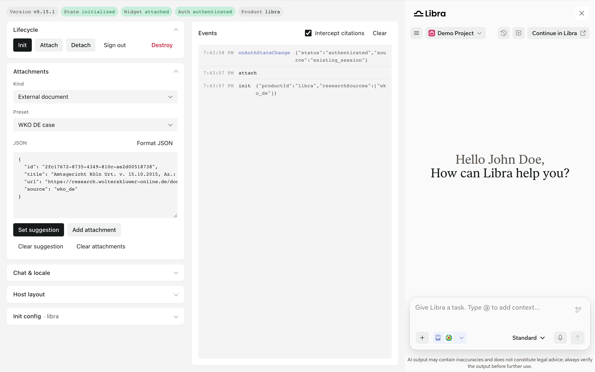

import { AnnotatedImage } from "/snippets/annotated-image.jsx"
import { screenshotMarkers } from "/versions/v0.15.0/snippets/screenshot-markers.jsx"

The SDK playground is a hosted page that embeds the SDK and has a control for each SDK call. Use it to see how the SDK behaves before you build, and to check what your product receives from callbacks.

| Playground | SDK build | Use it to |
| --- | --- | --- |
| [Release playground](https://sdk.staging.libratech.ai/versions/v0.15.0/playground.html) | `0.15.0`, the version these docs describe | Check documented behavior |
| [Latest staging](https://sdk.staging.libratech.ai/playground.html) | The current staging build, which can include unreleased changes | Preview what's coming |

Sign in with your Libra staging account. Both pages also have **Docs** and **Changelog** tabs.

<AnnotatedImage
  markers={screenshotMarkers["sdk-playground-overview"]}
  list="below"
  items={[
    { title: "Status", text: "SDK version, lifecycle state, sign-in state, and productId." },
    { title: "Lifecycle", text: "init, attach, detach, sign out, and destroy." },
    { title: "Attachments", text: "suggest or attach a document or a file." },
    { title: "Chat & locale", text: "open a chat by ID and change the language." },
    { title: "Host layout", text: "chat side, width, a host overlay, and a second page." },
    { title: "Init config", text: "the options passed to Libra.init()." },
    { title: "Intercept citations", text: "claims citation clicks in onCitationClick." },
    { title: "Events", text: "every call and callback, with its data." },
    { title: "SDK window", text: "the SDK as your users see it." },
  ]}
>
  
</AnnotatedImage>

## What you can try

| Control | What it calls |
| --- | --- |
| **Init**, **Attach**, **Detach**, **Destroy** | `Libra.init()`, `Libra.attach('chat')`, `Libra.detach()`, `Libra.destroy()`. Detach and attach again: the chat is still there. |
| **Sign out** | `Libra.signOut()` |
| **Set suggestion**, **Clear suggestion** | `Libra.setSuggestedAttachment()` and `Libra.clearSuggestedAttachment()`. Pick a preset (two Wolters Kluwer Online cases, one with an attachment) or edit the JSON. |
| **Add attachment**, **Clear attachments** | `Libra.addAttachments()` and `Libra.clearAttachments()`. **Kind** switches between an external document and a file from your computer. |
| **Open chat** | `Libra.openChatById()` with the chat ID you enter. |
| **Locale** | `Libra.setLocale()` |
| **Init config**, then **Apply & re-init** | Starts the SDK again with the `productId`, research sources, locale, `zIndex`, and `onClose` you choose. Without `onClose`, the SDK hides its top bar and **Close** button. **Copy code** copies the matching `Libra.init()` call. |
| **Intercept citations** | When on, `onCitationClick` calls `preventDefault()` and logs the citation instead of opening a new tab. |
| **Chat on the left**, **Widget width** | Moves and resizes the area your page gives the SDK, from 280px to 800px. |
| **Host overlay** | Shows a page element with `z-index: 12` above the SDK, which uses `zIndex: 5`. See [Mounting and positioning](/versions/v0.15.0/integration/lifecycle#mounting-and-positioning). |
| **Playground 2** | Loads a second page. The session is restored after the full page load. |

The playground remembers your settings in this browser. **Reset** in **Init config** restores the defaults: `productId: 'libra'` and web search as the research source.

The **Events** log shows each call and each callback (`onAuthStateChange`, `onAuthError`, `onCitationClick`, and `onClose`) with its data. The browser console shows the same entries.

## Screenshots in these docs

Screenshots and videos in these docs come from the release playground. They show only the SDK, not the playground controls.

See [Quickstart](/versions/v0.15.0/integration/quickstart) to add the SDK to your product and the [API reference](/versions/v0.15.0/reference/overview) for every method and option.
